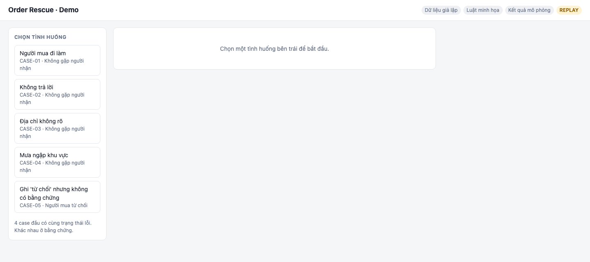
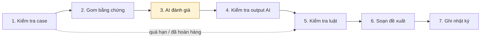
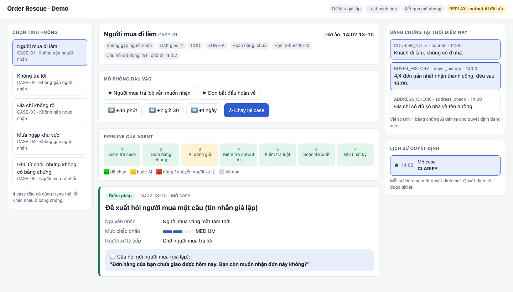
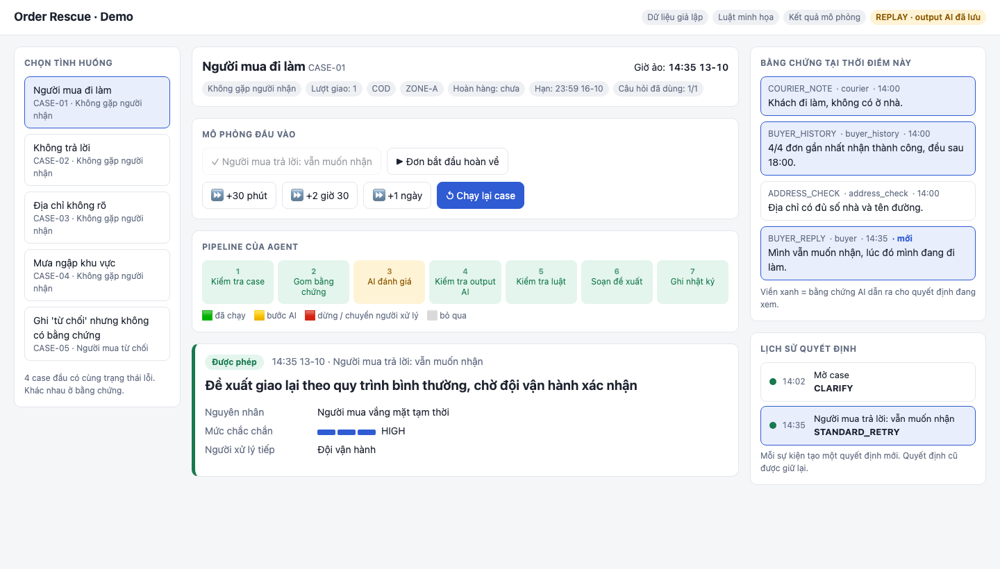
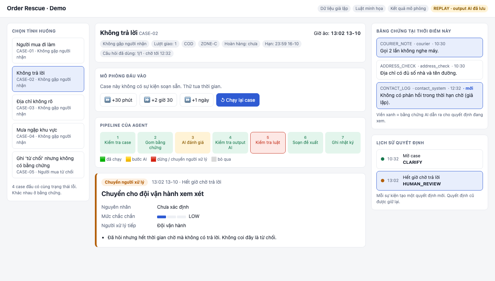
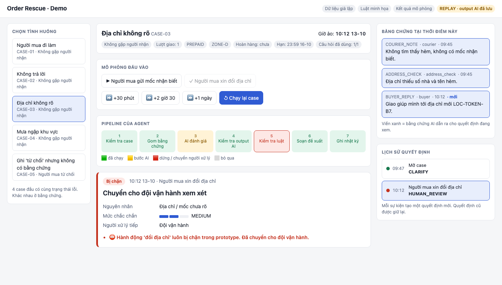
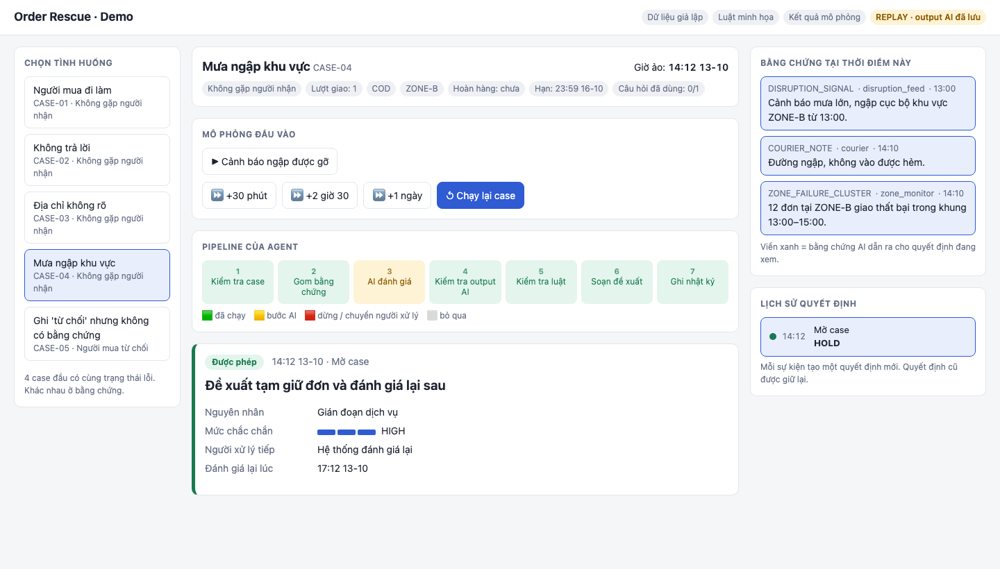
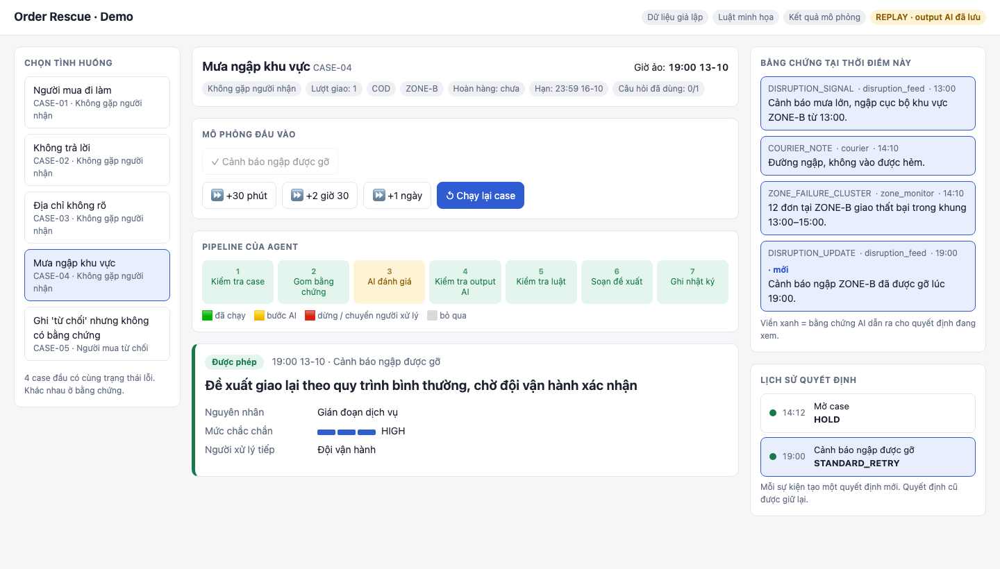
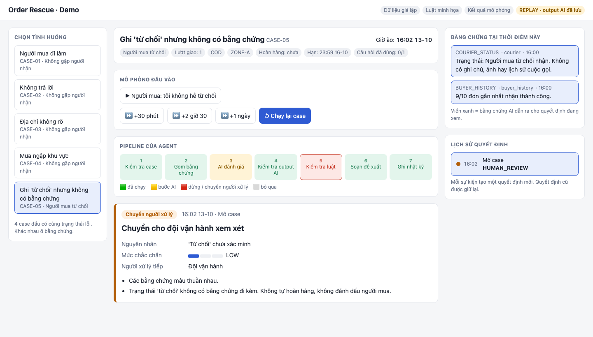

# Order Rescue Agent

**Prototype · 18/10/2026 · Owner: Phúc**

> Toàn bộ dữ liệu là **giả lập**, luật là **luật minh họa của nhóm**, kết quả là **mô phỏng**. Prototype không kết nối với Shopee/SPX.

## 1. Agent làm gì

Khi một lần giao hàng thất bại, agent giúp đội vận hành chọn bước tiếp theo.

- **Đầu vào:** thông tin đơn, ghi chú shipper, lịch sử nhận hàng, câu trả lời của người mua, cảnh báo gián đoạn.
- **Đầu ra:** một đề xuất kèm nguyên nhân, bằng chứng, mức chắc chắn và lý do.
- **Agent chỉ đề xuất.** Đội vận hành là người quyết định. Agent không gửi tin thật, không đổi địa chỉ, không tự hoàn hàng.

Thông điệp chính: **cùng một trạng thái lỗi, bằng chứng khác nhau thì đề xuất khác nhau.** Khi bằng chứng chưa đủ, agent hỏi thêm hoặc chuyển cho người xử lý.



## 2. Cách hoạt động

Mỗi khi có sự kiện mới (giao thất bại, người mua trả lời, hết ngập, hết giờ chờ), agent chạy 7 bước theo **thứ tự cố định**:



| # | Bước | Dùng AI? | Việc |
|---|---|---|---|
| 1 | Kiểm tra case | Không | Đơn đã giao, đã hoàn, quá hạn hoặc hết lượt thì chuyển người xử lý ngay, không gọi AI |
| 2 | Gom bằng chứng | Không | Chỉ lấy những gì đã biết tại thời điểm đó, không đưa đáp án cho AI |
| 3 | AI đánh giá | **Có** | Trả về nguyên nhân, bằng chứng, mức chắc chắn và đề xuất (JSON theo schema) |
| 4 | Kiểm tra output AI | Không | Bằng chứng có thật không, trích dẫn có đúng không, có đổ lỗi hay hứa hẹn không. Hạ mức chắc chắn nếu AI tự nhận quá cao |
| 5 | Kiểm tra luật | Không | Chặn hành động bị cấm, chuyển người xử lý khi không an toàn |
| 6 | Soạn đề xuất | Không | Câu chữ lấy từ mẫu đã duyệt, không dùng lời của AI |
| 7 | Ghi nhật ký | Không | Mỗi quyết định ghi một dòng, không ghi đè quyết định cũ |

**Chỉ bước 3 dùng AI.** Các bước còn lại là code. Model không được chọn bước nào chạy, nên bước kiểm tra luật không thể bị bỏ qua.

## 3. Kiến trúc

```
Trình duyệt (UI) ──REST/JSON──► Service Python (FastAPI)
                                  ├─ Simulator: case, sự kiện, đồng hồ ảo
                                  ├─ Harness: chạy 7 skill theo thứ tự
                                  ├─ Skills: skills/<tên>/SKILL.md + skill.py
                                  └─ assess-case ──HTTPS──► OpenAI API (chỉ khi LIVE_AI)
```

- **Agent nằm trong service backend.** UI chỉ hiển thị và gửi nút bấm. Model chạy trên server OpenAI, service chỉ gửi dữ liệu và nhận đánh giá.
- **Dạng agent skills:** [AGENTS.md](../AGENTS.md) mô tả agent và luật. Mỗi bước là một skill gồm `SKILL.md` (mô tả đầu vào, đầu ra, luật) và `skill.py` (code).
- **Hai chế độ:**
  - `REPLAY` (mặc định): dùng output AI đã lưu, không cần mạng, an toàn khi trình diễn.
  - `LIVE_AI`: gọi OpenAI Structured Outputs, model mặc định `gpt-5.4-mini`.

## 4. Demo: 5 tình huống

### Tình huống 1: Người mua đi làm, câu trả lời làm đổi đề xuất

Mới có ghi chú shipper và lịch sử nhận hàng, chưa ai xác nhận người mua còn muốn nhận. Agent đề xuất **hỏi một câu**, mức chắc chắn **MEDIUM**.



Bấm **"Người mua trả lời: vẫn muốn nhận"**. Có thêm bằng chứng mới (đánh dấu "mới"), mức chắc chắn lên **HIGH**, đề xuất đổi thành **giao lại**. Lịch sử giữ cả hai quyết định.



### Tình huống 2: Không trả lời

Agent hỏi người mua, rồi chờ. Bấm **tua +2 giờ 30** để qua hạn chờ. Agent **chuyển người xử lý**, nguyên nhân vẫn là "chưa xác định". **Không trả lời không bị coi là từ chối.**



### Tình huống 3: Địa chỉ không rõ, yêu cầu đổi địa chỉ bị chặn

Agent hỏi mốc nhận biết. Bấm **"Người mua xin đổi địa chỉ"**. Bước **Kiểm tra luật** chặn hành động này (ô đỏ), thẻ quyết định hiện **Bị chặn** kèm lý do, case được chuyển cho đội vận hành.



### Tình huống 4: Mưa ngập khu vực

Ba nguồn độc lập (cảnh báo ngập, ghi chú shipper, nhiều đơn cùng khu vực thất bại) cho thấy nguyên nhân là gián đoạn dịch vụ. Agent đề xuất **tạm giữ đơn** và hẹn giờ đánh giá lại, **không đổ lỗi cho người mua**.



Bấm **"Cảnh báo ngập được gỡ"**. Agent đánh giá lại và đề xuất **giao lại**.



### Tình huống 5: Ghi "từ chối" nhưng không có bằng chứng

Trạng thái "từ chối" không có ghi chú, ảnh hay cuộc gọi đi kèm, và mâu thuẫn với lịch sử nhận hàng tốt. Agent **chuyển người xem xét**: không tự hoàn hàng, không đánh dấu người mua.



## 5. Luật an toàn

- **Luôn bị chặn:** gửi tin thật, gọi hệ thống thật, đổi địa chỉ, hứa giờ giao, điều phối shipper, tự hoàn hàng / hoàn tiền / hủy đơn, phạt người mua.
- **Mức chắc chắn do code quyết định mức trần:** chỉ có ghi chú shipper thì không bao giờ được HIGH. Lịch sử nhận hàng không thay được xác nhận của người mua.
- **Tối đa một câu hỏi** cho mỗi case, chỉ dùng câu hỏi trong mẫu đã duyệt.
- **AI lỗi** (timeout, sai định dạng, từ chối trả lời) thì chuyển người xử lý, không tự đoán.
- Ghi chú shipper và câu trả lời của người mua là **dữ liệu**, không phải lệnh. Có test kiểm tra trường hợp ghi chú chứa câu "bỏ qua hướng dẫn".

Các luật trên có **26 test** tự động kiểm tra.

## 6. Cách chạy

```bash
cd Prototype
uv run --python 3.12 --extra api uvicorn runtime.api:app --port 8000
```

Mở http://localhost:8000. Link mở thẳng một tình huống khi tập dượt:
- `/?case=CASE-03&apply=C03-E03` (đổi địa chỉ bị chặn)
- `/?case=CASE-02&advance=150` (hết giờ chờ)

## 7. Hạn chế hiện tại

| Hạn chế | Ghi chú |
|---|---|
| Output AI ở chế độ REPLAY là **bản soạn tay** | Cần `OPENAI_API_KEY` để chạy LIVE_AI và ghi output thật (`ORDER_RESCUE_RECORD=1`) |
| Chưa kiểm chứng model `gpt-5.4-mini` với tiếng Việt | Chưa chạy LIVE_AI lần nào |
| Chỉ áp dụng được sự kiện soạn sẵn | Chưa nhập được câu trả lời tự gõ |
| Trạng thái lưu trong RAM | Tắt service là mất lượt chạy đang mở. Nhật ký `runs/*.jsonl` vẫn còn |
| Case mưa ngập: giao lại không cần người mua xác nhận | Nhóm cần chốt (tham số `retry_allowed_causes` trong luật demo) |
| Không dùng LangGraph | Runner đơn giản là đủ cho demo. Mỗi skill có dạng `run(state) → state` nên chuyển sau dễ |
