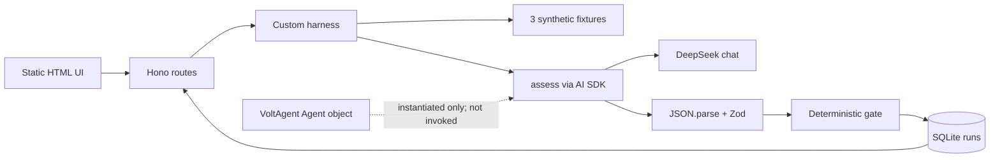

# Order Rescue external review

## 1. Verdict

The synthetic demo compiles and its basic two-assessment/no-reply state transitions work with a test double. It is not yet a validated BI v2.2 implementation. The supplied 30-case schema and test JSON are missing, live DeepSeek was unavailable, and deterministic policy currently trusts unvalidated model-generated semantic facts. Lifecycle-blocked cases can also remain unfinished. Verdict: **development prototype; not ready for BI acceptance or operational recommendation use**.

## 2. Versions and environment

- Commit: `e52194f4af805c6d41d283c2fb19c3f1aed8c69c`; dirty worktree: yes. `volt-app/`, `volt-app.zip`, and the implementation plan were already untracked. No tracked application changes were made.
- BI supplied: Business Rules v2.2 and ERD v2.2, pair `order-rescue-demo-30-v2.2`. Read completely. Missing: `Order_Rescue_Data_Model_30_Cases_v2.2.json`, `Order_Rescue_Test_Cases_30_v2.2.json`, and referenced `Order_Rescue_Minimal_Simulation_30_Cases_v2.1.xlsx`.
- Node 25.1.0, npm 11.6.2, Python 3.13.5; `uv` absent. Lockfile v3. Installed: VoltAgent 2.11.0, AI SDK 6.0.317, DeepSeek provider 1.0.0, better-sqlite3 12.11.1, Hono 4.13.14, Zod 4.6.7, TypeScript 5.9.3, tsx 4.23.15. Some exceed caret-based manifest minima.
- Requested model defaults to `deepseek-chat`. Live response model is unknown. Structured output is a plain JSON instruction followed by `JSON.parse` and Zod—not provider-native structured output.

## 3. Actual architecture

`public/index.html` sends start/reply/no-reply requests and renders escaped JSON. `server.ts` maps five routes. `harness.ts:inputFor` builds a seven-field input plus source registry from in-memory fixtures; it never reads the BI relational model. `agent.ts:assess` makes the only LLM request. The assessment, internal `decision_facts`, and buyer question are generated in one request; there is no separate question-generation call and no tools. `agent` (VoltAgent) is constructed but execution calls AI SDK `generateText` directly. `harness.ts:gate` decides policy. `start`, `reply`, and `noReply` own transitions and SQLite writes.

The model receives the failed event, attempts, lifecycle/deadline, empty history, fixture operational context, available T0/reply text, and a source registry. Expected answers/future scripted replies are absent. SQLite persists run state, initial/final objects, question, reply, metadata, and one JSON event array; it survives restart. Fixtures remain file/in-memory data. In-flight requests and failures are not persisted.

File/function map: `src/domain.ts` schemas/types; `src/agent.ts:assess` DeepSeek call/parsing; `src/harness.ts:inputFor` adapter, `gate` policy, `start/reply/noReply` workflow, `view/getRun` reads; `src/server.ts` HTTP; `public/index.html:draw` UI; `tests/workflow.test.ts` one schema-only test.

Implemented: synthetic UI/API, one-question happy path, exact final copying, SQLite restart. Intended/unverified: nine-table BI adapter, 30 cases, full policy profile, semantically grounded extraction, production-grade idempotency, and VoltAgent orchestration.

## 4. Traced example

With an isolated SQLite DB and deterministic assessor, `SYN-01` stored an initial `AVAILABILITY_ISSUE/MEDIUM`, missing intent and availability, then policy `CLARIFY`. Only after persistence it stored a PENDING question. A matching free-text reply (“Yes; someone will receive tomorrow”) produced a complete `HIGH` after-reply assessment, policy `STANDARD_REATTEMPT`, source `2`, and `COMPLETED`; final assessment/policy were byte-equivalent after JSON parsing to the selected phase-two objects. A separate manual no-reply made zero additional assessment calls, left both after-reply fields null, and copied initial assessment/policy to source `1`.

## 5. Findings (severity order)

### HIGH — Policy trusts unvalidated model semantic facts

- File/line/function: `src/harness.ts:5`, `gate`; `src/agent.ts:6,9`, `envelope/assess`.
- Evidence: retry is permitted when model-only `facts.intent/availability/cod_readiness` say `CONFIRMED`; no backend provenance or entailment check exists. Short excerpt: `facts.intent==='CONFIRMED'&&facts.availability==='CONFIRMED'`.
- Trigger: a test double interpreted intent-only “I still want the parcel” as availability confirmed and empty missing info; policy permitted retry.
- Impact: intent, HIGH confidence, or empty missing info can indirectly authorize retry despite the BI rule.
- Fix: validate provenance-bound extracted facts independently; require explicit availability/COD evidence and conflict handling before policy.

### HIGH — Existing source IDs can have invented provenance or unsupported facts

- File/line/function: `src/harness.ts:8-9`, `start/reply`.
- Evidence: validation is only `if(!input.sources[e.source_ref])`; it does not compare `verification`, source text, quote support, ownership, or semantic entailment. A NOTE source labeled `VERIFIED_OPS_SIGNAL` was accepted.
- Trigger: return a valid existing source ID with upgraded verification or unrelated fact.
- Impact: provenance can be upgraded and claims can be fabricated while schema/source checks pass.
- Fix: enforce source-to-verification mapping and provenance-aware claim validation; never treat mere source existence as entailment.

### HIGH — Lifecycle gates do not complete a durable recommendation

- File/line/function: `src/harness.ts:8`, `start`.
- Evidence: return-started returns only `{precheck:'UNKNOWN'}` without persistence. Expired deadline and attempts `>=3` still call the model, then persist `state='ASSESSED'`, `final=null`; active disruption behaves similarly.
- Trigger: isolated cases for STARTED, expired, exhausted attempts, or verified active disruption.
- Impact: unnecessary model use and stranded runs with no final/COMPLETED semantics.
- Fix: perform all lifecycle gates before AI and durably finalize the deterministic blocked/escalated outcome.

### MEDIUM — Event idempotency is incomplete

- File/line/function: `src/harness.ts:9-10`, `reply/noReply`; table DDL at line 2.
- Evidence: no unique event table/index or payload hash; event IDs are merely stored in a one-element JSON array. State guards prevent a second finalization, but same-ID/same-payload and same-ID/different-payload both become generic conflicts.
- Impact: retries are not idempotent and payload conflicts are not auditable.
- Fix: transactionally reserve event ID plus payload hash, return the prior result for exact duplicates, reject mismatched reuse distinctly.

### MEDIUM — Phase-two input snapshot is not persisted

- File/line/function: `src/harness.ts:2,4,9`, DDL/inputFor/reply.
- Evidence: only initial `input` is stored; reply input is rebuilt from current fixture data, while only reply text and output survive.
- Impact: an after-reply historical view cannot prove the exact complete input/source registry assessed.
- Fix: persist immutable input snapshot and hash per assessment.

### MEDIUM — Failures are HTTP errors, not durable review outcomes

- File/line/function: `src/agent.ts:9`, `assess`; `src/harness.ts:8-9`; `src/server.ts:2`.
- Evidence: invalid JSON/Zod/invented source throws before insert/update; API returns 400/409. No HUMAN_REVIEW run is written.
- Impact: model failures disappear from workflow/audit history and waiting cases can remain pending.
- Fix: record a deterministic failure outcome and audit metadata without silently substituting an assessment.

### LOW — VoltAgent is nominal, and status report overstates output mode

- File/line/function: `src/agent.ts:8-9`; `reports/implementation-status.md:9`.
- Evidence: exported VoltAgent `agent` is never used; the report claims `Output.object`, absent from code.
- Impact: reviewers may misunderstand framework responsibilities and structured-output guarantees.
- Fix: document direct AI SDK execution accurately or route execution through a deliberately selected VoltAgent API.

## 6. Test evidence

- `npm run typecheck`: PASS. `npm test`: PASS, 1 schema-only test. `npm run build`: PASS.
- Temporary venv: `python3 -m venv /tmp/...; pip install pydantic pytest fastapi httpx uvicorn; python -m pytest -q`: PASS, 26 tests, one deprecation warning.
- HTTP with isolated `DB_PATH`: GET `/`, GET `/api/cases` PASS; POST `/api/runs` returned expected 400 because DeepSeek key is unavailable.
- Ad hoc copied-harness scripts exercised A–I: happy reply, no-reply, wrong question, duplicate/no double-final, same ID changed payload, restart, lifecycle/deadline/attempts, provenance/invented semantic facts, and historical input. Commands used `DB_PATH=/tmp/... ./node_modules/.bin/tsx review-check.ts`, `lifecycle-check.ts`, and semantic/provenance variants in a temporary app copy; assertions and test doubles are described above. Temporary files were removed.
- Browser E2E: NOT_TESTED (no suite/tooling present). Live DeepSeek: BLOCKED—`DEEPSEEK_API_KEY` unavailable; 0 requests, no retries. Original 30-case evaluation: BLOCKED—required JSON files absent.

## 7. BI compliance matrix

| Check | Result | Evidence |
|---|---|---|
| Save initial assessment/policy before asking | PASS | insert contains both plus question in one transaction |
| At most one question | PASS | one pending question; no second-question path |
| Reply matches pending run/question | PASS | state and question ID guard |
| Valid reply creates complete phase two | PASS | test-double trace |
| No-reply makes no assessment call; phase two null | PASS | call counter and DB fields |
| Final exactly copies selected assessment/policy; no third assessment | PASS | deep equality; call count 2/1 |
| Correct final source and COMPLETED | PASS for reply/no-reply; FAIL for non-question initial outcomes | stranded ASSESSED runs |
| Duplicate cannot finalize twice | PASS | state guard |
| Idempotent duplicate/payload conflict semantics | FAIL | no event uniqueness/hash |
| No automatic reply timeout | PASS | none found |
| Historical snapshot per assessment | FAIL | phase-two input absent |
| Original 30-case BI suite | BLOCKED | two JSON artifacts missing |

## 8. Semantic hardcoding and leakage

No application code uses case IDs, titles, scenario labels, regexes, or keyword lists to infer intent, availability, COD, refusal, address meaning, hypothesis, confidence, or recommendation. The only regex is legitimate HTML escaping; `includes('COD')` is a configured payment constraint. Expected answers and scripted future replies do not exist in the three development fixtures and do not enter prompts. Free text is not matched to fixture answers. However, the LLM performs all semantic extraction—including address clarification/change, conditional availability, refusal, and the internal decision facts—and backend validation is insufficient. The Ops active-disruption gate correctly remains authoritative over buyer reply.

## 9. Remaining LLM extraction risks

Schema validity does not prove semantic correctness. Negation, conditions, conflicts, current versus historical intent, COD readiness, and address clarification versus change can all be misread. The model also generates the question in the same call; its text is only checked for non-nullness, not safety or alignment. No live negation/conditional behavior was verified.

## 10. Recommended next fixes

1. Add provenance-bound semantic fact validation before policy, especially retry prerequisites and active Ops conflicts.
2. Make all prechecks deterministic, persisted, final, and model-free.
3. Add transactional event idempotency with payload hashes and per-assessment input snapshots.
4. Persist model/validation failures as review outcomes.
5. Obtain the two authoritative v2.2 JSON files, implement the real adapter/profile, then run the untouched 30-case evaluator.
6. Add API and browser tests; only then run a bounded live DeepSeek semantic set.
